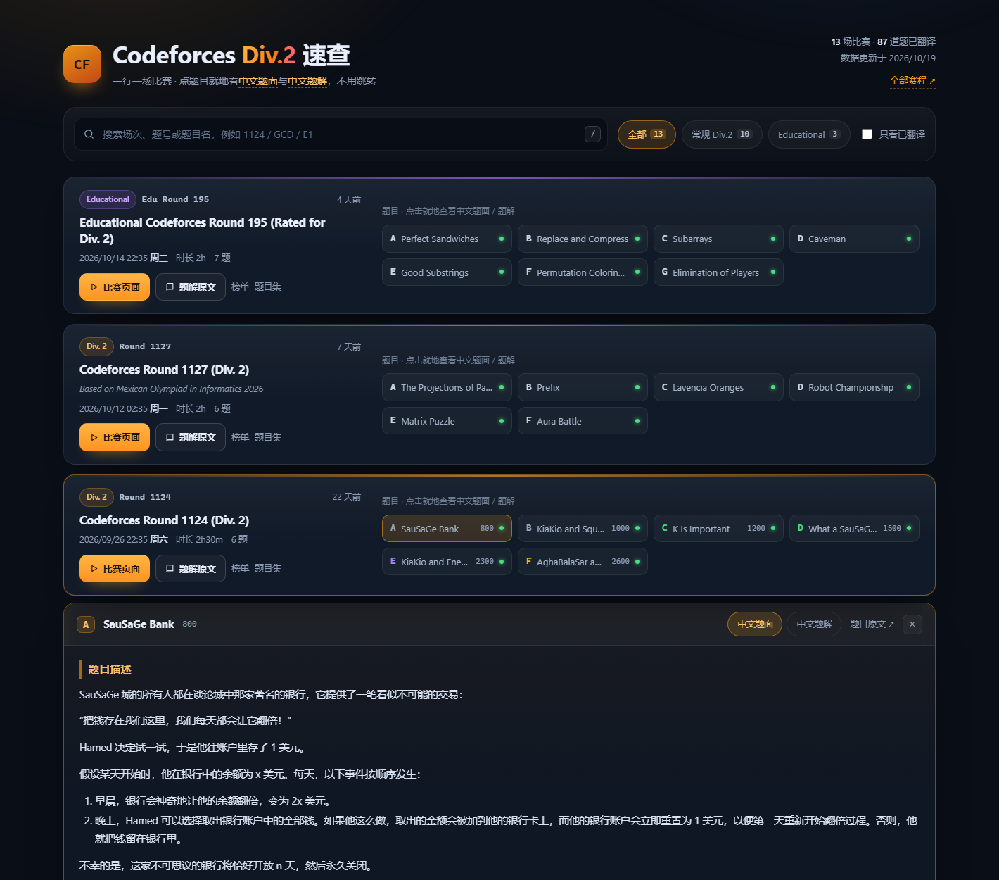

# Codeforces Div.2 速查（中文题面 + 中文题解）

一个纯静态网页：**横版一行一场比赛**，点题目卡片就地展开**中文翻译的题面**，再点「中文题解」标签就能看**中文翻译的官方题解**——全程不跳转。



## 直接使用

双击 `index.html` 即可（纯本地文件，不需要服务器、不需要联网）。

页面内所有外链（比赛页面、题解原文、榜单、题目集）都在新标签打开，方便对照英文原文。

## 页面怎么用

| 操作 | 效果 |
| --- | --- |
| 点某个题目（如 `A SauSaGe Bank`） | 在该行下方就地展开**中文题面**，再点一次收起 |
| 面板里的「中文题解 / 中文题面」标签 | 在题面与题解之间切换 |
| 「题目原文 ↗ / 题解原文 ↗」 | 跳 Codeforces 英文原页面 |
| 搜索框（按 `/` 聚焦） | 按场次号、题号、题名过滤，例如 `1124`、`GCD`、`E1` |
| 筛选 | 全部 / 常规 Div.2 / Educational / 只看已翻译 |
| 绿色小圆点 | 该题已有中文题面 |
| `Esc` | 收起面板 / 清空搜索 |
| 链接带 `#p=2269-A` | 直接打开该题题面（加 `:editorial` 打开题解），可分享 |

数据快照：最近 13 场 Div.2（10 场常规 + 3 场 Educational），共 87 道题。

## 目录结构

```
codeforces-div2/
├─ index.html                 页面骨架
├─ assets/
│  ├─ style.css               深色主题样式（横版行布局、响应式）
│  ├─ app.js                  渲染、筛选、搜索、Markdown 渲染、题面/题解面板
│  ├─ data.js                 场次与题目元数据（比赛 ID、时间、难度分、题解博客 ID）
│  └─ content.js              ← 由 tools/build-content.js 生成（中文题面 + 题解）
├─ data/
│  ├─ raw/<contestId>-<题号>.md       人工/机器翻译的题面（带 front matter）
│  └─ editorial/<contestId>-<题号>.md 翻译的官方题解
├─ tools/
│  ├─ build-content.js        把 data/ 下的 md 打包成 assets/content.js
│  └─ verify.js               内容完整性自检
├─ preview.png                桌面端预览
└─ preview-mobile.png         手机端预览（390px）
```

## 更新数据

### 1. 增加一场比赛

在 `assets/data.js` 的 `contests` 数组里加一条：

```js
{
  id: 2280,                       // https://codeforces.com/contest/2280
  kind: "div2",                   // "div2" 常规 / "edu" Educational
  round: "1129",
  title: "Codeforces Round 1129 (Div. 2)",
  note: "",                       // 附加信息，如 "Based on ..."
  start: 1793000000,              // 开赛时间戳（秒）
  duration: 7200,                 // 时长（秒）
  editorial: 157800,              // 官方题解博客 ID → /blog/entry/157800
  problems: [{ index: "A", name: "Some Problem", rating: 800 }]
}
```

- 场次/时间/时长：`https://codeforces.com/api/contest.list?gym=false`
- 题目与难度分：`https://codeforces.com/api/contest.standings?contestId=<id>`（读 `result.problems`，注意不能加额外参数）
- 题解博客 ID：比赛页右侧「Contest materials → Tutorial (en)」

### 2. 加一条翻译

- 题面写到 `data/raw/<contestId>-<题号>.md`，格式为 front matter + markdown：

````markdown
---
contestId: 2269
index: A
name: SauSaGe Bank
timeLimit: 1 秒
memoryLimit: 256 MB
---
## 题目描述
...
### 输入格式
...
### 输出格式
...
### 样例
**输入**
```text
...
```
**输出**
```text
...
```
````

- 题解写到 `data/editorial/<contestId>-<题号>.md`，用 `## 思路` / `## 实现要点` 两节即可。

### 3. 重新打包并自检

```powershell
node tools/build-content.js   # 生成 assets/content.js
node tools/verify.js          # 检查 87 题是否齐全、有无 LaTeX 残留
```

刷新页面即可看到新内容，无需构建工具。

## 说明

- 中文题面/题解由机器翻译后人工校对流程生成，**仅供理解题意**，细节（尤其是样例格式、特殊约定）以 Codeforces 英文原文为准。
- 站点只做链接与文本聚合，题面与题解版权归 Codeforces 及各原作者所有。
- 刚结束的比赛官方可能还没定题目难度分，此时不显示分数。
